# CYD 날씨 스테이션 – 한국판

<p align="center">
  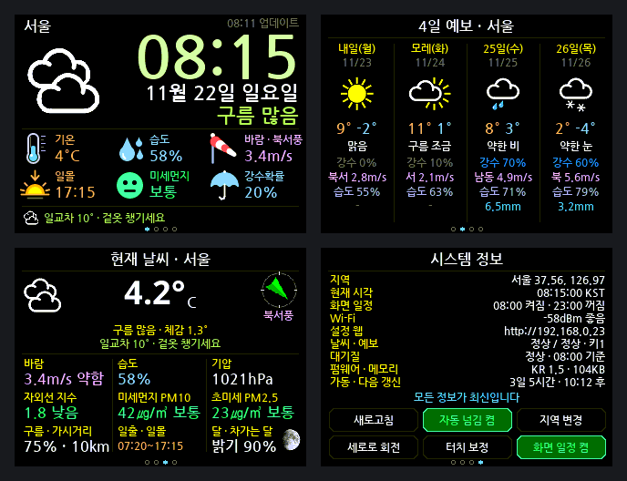
</p>
<p align="center">
  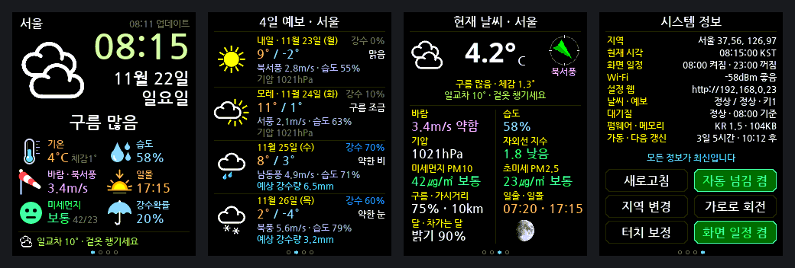
</p>

<p align="center">
  ESP32 "Cheap Yellow Display"(ESP32-2432S028R)를 위한 <b>한국어 날씨 대시보드</b>입니다. 세로 · 가로 화면을 모두 지원합니다.<br>
  시계 · 날씨 · 미세먼지 · 강수확률 · 생활 안내를 한 화면에 보여주고, 아침 8시에 켜져 밤 11시에 꺼집니다.<br>
  지역 · 화면 일정 · 밝기 · Wi-Fi 는 휴대폰으로 <b>내부망 설정 웹</b>에서 바꿀 수 있습니다.
</p>

<p align="center">
  
  
  
  
</p>

[Rau7han/ESP32-CYD-Weather-Station](https://github.com/Rau7han/ESP32-CYD-Weather-Station) v3.1(인도 벵갈루루 기준, 영어, 가로 화면)을
한국 환경에 맞게 고치고 기능을 보강한 버전입니다.

---

## 원본과 달라진 점

| 항목 | 원본 (v3.1) | 한국판 |
| --- | --- | --- |
| 화면 | 가로 320×240, 하단 탭 | **가로 320×240(기본) / 세로 240×320 대시보드** 둘 다 (큰 시계 · 날짜 · 요일 · 큰 날씨 아이콘 · 아이콘 정보 칸), 버튼 하나로 전환. 가로는 머리맡에서 잘 보이게 **66px 큰 시계** |
| 언어 | 영어 | **전체 한국어** (나눔고딕 Bold 기반 한글 글꼴 4종 내장) |
| 날씨 설명 | API 영어 문구 | 날씨 코드 → 자연스러운 한국어 (맑음 · 구름 많음 · 약한 비 · 진눈깨비 · 황사 …) |
| 시간대 / 시계 | IST(UTC+5:30), 해외 NTP | **KST(UTC+9)**, 한국표준과학연구원 `time.kriss.re.kr` → `kr.pool.ntp.org` → Google |
| 날짜 표기 | `SAT JUN 20` | `11월 22일` / `일요일`, 예보는 `내일` · `모레` |
| 지역 | 벵갈루루 고정 | 전국 **28개 도시 프리셋**, 화면 버튼으로 바꾸고 전원을 꺼도 기억 |
| 대기질 | 자외선만 | **미세먼지(PM10) · 초미세먼지(PM2.5)** 추가 (키 필요 없음) |
| 등급 표기 | 없음 | 환경부 미세먼지 4단계, 기상청 자외선 5단계, 기상청 바람 세기 표현, 등급별 색상 |
| 생활 안내 | 없음 | 폭염 · 한파 · 비/눈 · 강풍 · 우산 · 마스크 · 선크림 · 일교차 안내 한 줄 |
| 예보 | 최고/최저, 강수량 | + **강수확률**, 12시간 강수확률, 24시간 최고/최저, 풍향 한국어 |
| 화면 일정 | 항상 켜짐 | **08:00 켜짐 · 23:00 꺼짐** (밤에 터치하면 30초 동안 켜짐) |
| 시스템 화면 | 버튼 3개 | 버튼 6개(새로고침 · 자동 넘김 · 지역 변경 · 화면 회전 · 터치 보정 · 화면 일정), IP · 가동 시간 · 화면 일정 표시 |
| 오류 표시 | `API status: 401 / 200 / 200` | `현재 날씨 실패: API 키 거부(401) · 새 키는 최대 2시간 후 활성` |
| 첫 부팅 | 기본 터치값 | **터치 보정 자동 시작**, 보정값은 세로/가로 따로 저장 |
| 설정 방법 | 코드 수정 후 다시 업로드 | **내부망 설정 웹** (`http://cyd-weather-kr.local`): 지역(직접 좌표 입력 포함) · 화면 일정 · 밝기 · 방향 · Wi-Fi · 관리 비밀번호. Wi-Fi 정보가 없으면 **Wi-Fi 설정 모드**(휴대폰으로 연결) |
| 개발 도구 | – | 한글 글꼴 생성기, PC 화면 미리보기(실제 UI 코드를 PC에서 그려 봄), 설정 웹용 가짜 기기 서버 |

---

## 화면 구성

화면은 4장이고, **좌우로 밀거나** 화면을 **탭**해서 넘깁니다. (왼쪽 1/4 탭 = 이전, 나머지 = 다음) 아래쪽 점 4개가 현재 화면 위치입니다.

**가로 화면** (기본, 머리맡용)

| 홈 | 4일 예보 |
| --- | --- |
| 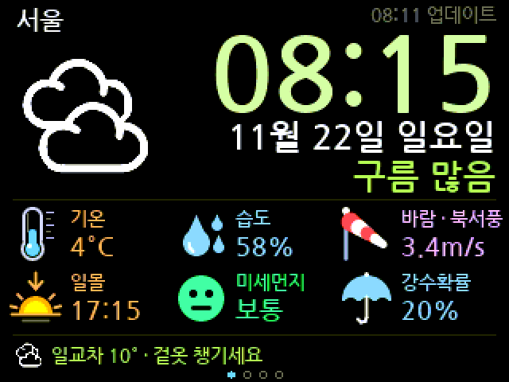 | 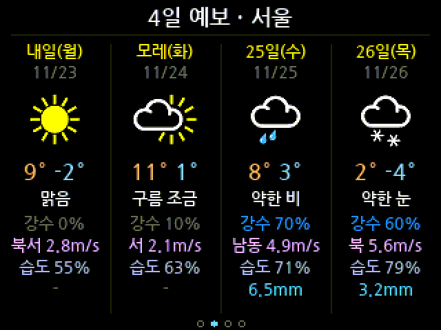 |
| **상세** | **시스템** |
| 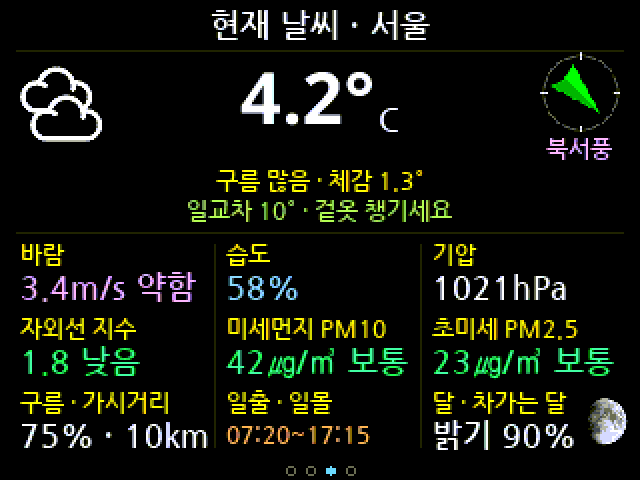 | 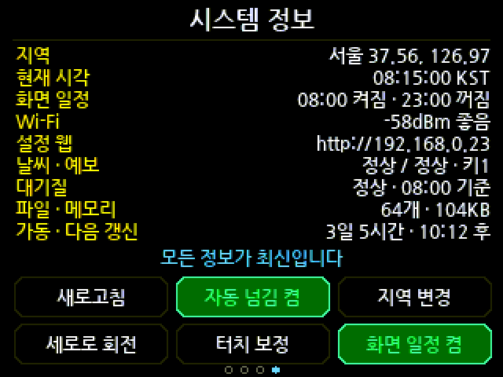 |

가로 화면은 침대에서 눈만 떠도 보이도록 시계를 **66px**로 크게 그리고, 시계 · 날짜 · 요일 · 날씨를 화면 위쪽 절반에 모았습니다.
정보 칸은 3열×2줄, 4일 예보는 날짜별 4개 열, 상세 정보는 3열 격자입니다.

**세로 화면** (시스템 → **세로로 회전**)

| 홈 | 4일 예보 | 상세 | 시스템 |
| --- | --- | --- | --- |
| 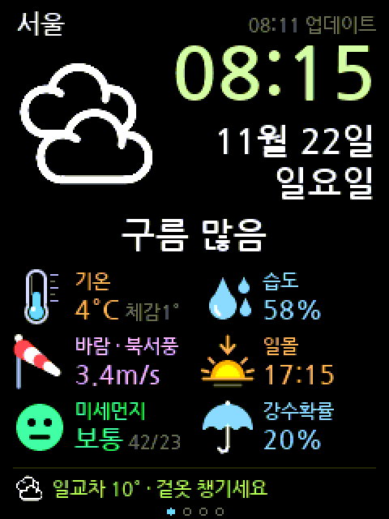 | 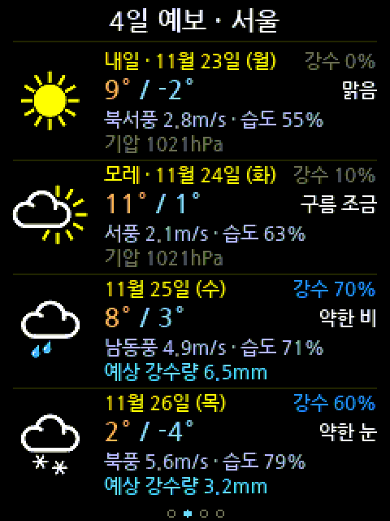 | 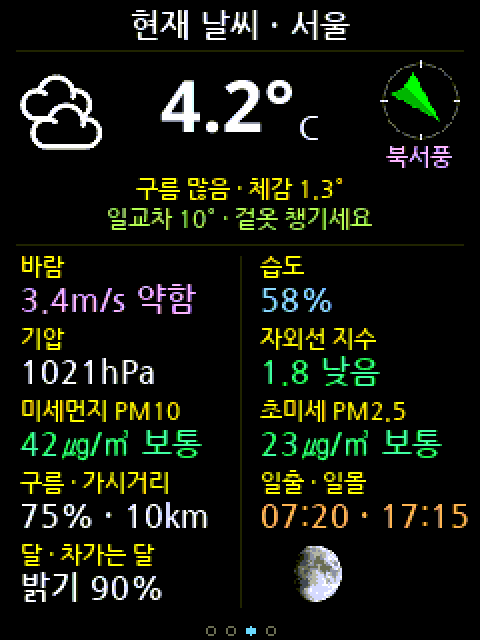 | 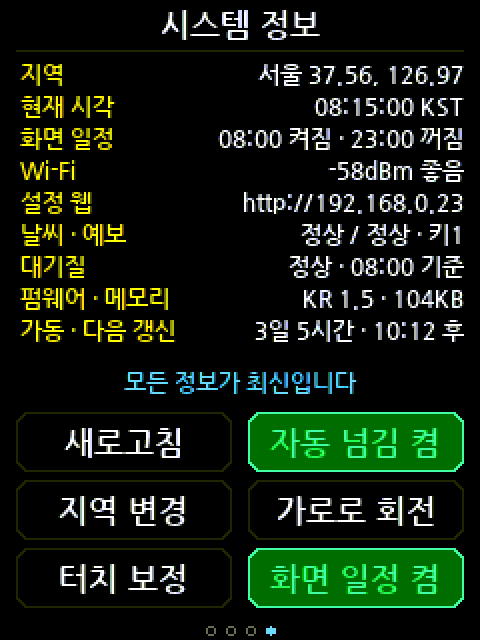 |

세로 화면은 칸 사이 여백이 넉넉하고 날씨 설명이 가운데에 크게 나와서 책상처럼 가까이 둘 때 좋습니다. 시계는 46px입니다.
방향은 펌웨어를 다시 올리지 않고 언제든 바꿀 수 있고, 고른 방향은 전원을 꺼도 기억합니다.

**홈**: 지역, 큰 시계, 날짜와 요일, 날씨 아이콘, 날씨 설명이 있고 아래에 6칸이 있습니다.

| 칸 | 내용 |
| --- | --- |
| 🌡 기온 | 현재 기온 + 체감온도. 온도계 수은주 높이와 색이 기온을 따라감 (0℃ 이하 파랑 → 25℃ 이상 빨강) |
| 💧 습도 | 상대습도 |
| 🎐 바람 | 풍속(m/s) + 풍향(예: 북서풍) |
| 🌅 일출/일몰 | 다음에 올 일출 또는 일몰 시각 (화살표 ↑ 일출, ↓ 일몰) |
| 😊 미세먼지 | PM10 · PM2.5 중 나쁜 쪽 등급. **등급마다 표정이 바뀝니다**: 좋음 😊 · 보통 😐 · 나쁨 😠 · 매우나쁨 방독면 (칸이 넉넉한 세로 화면에서는 `PM10/PM2.5` 수치도 표시) |
| ☂ 강수확률 | 앞으로 12시간 중 가장 높은 강수확률 |

<p align="center">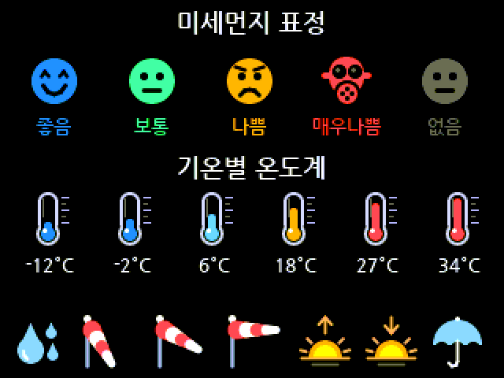</p>

맨 아래 줄은 생활 안내(있을 때)를 보여주고, 없으면 `구름 75% · 구름이 많은 하늘`처럼 하늘 상태를 보여줍니다.

비 오는 날에는 이렇게 바뀝니다 → 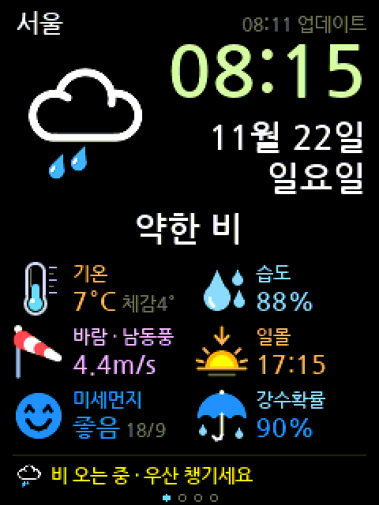

**4일 예보**: 내일부터 4일 동안의 최고/최저 기온, 강수확률, 날씨, 바람, 습도, 예상 강수량(없으면 기압)을 보여줍니다. 대표 날씨는 그날 정오에 가장 가까운 3시간 예보입니다.

**상세**: 큰 기온, 풍향 화살표, 체감온도, 생활 안내와 함께 바람 세기, 습도, 기압, 자외선, 미세먼지, 초미세먼지, 구름·가시거리(비 올 때는 1시간 강수량), 일출·일몰, 달 모양과 밝기를 보여줍니다.

**시스템**: 지역 좌표, 시각, 화면 일정, Wi-Fi 신호, IP, API 상태, 남은 메모리, 가동 시간, 다음 갱신까지 남은 시간을 보여줍니다. 아래에 버튼 6개가 있습니다.

---

## 준비물

| 항목 | 내용 |
| --- | --- |
| 보드 | **ESP32-2432S028R** (일명 CYD, 2.8인치 ILI9341 + XPT2046 저항막 터치, 4MB 플래시). 알리익스프레스나 국내 쇼핑몰에서 "ESP32-2432S028R" 또는 "CYD"로 검색하세요. |
| 케이블 | **데이터 전송용** USB 케이블 (충전 전용 케이블은 PC가 보드를 인식하지 못합니다). 보드에 따라 Micro-USB 또는 USB-C |
| Wi-Fi | **2.4GHz** 공유기. `iptime_5G`처럼 5GHz 전용 이름에는 연결되지 않습니다. |
| API 키 | [OpenWeather](https://home.openweathermap.org/users/sign_up) 무료 키 1개 (미세먼지·자외선은 키 없이 Open-Meteo 사용) |
| PC | Arduino IDE **2.2.1 이상** |

> ⚠️ **Windows 사용자 이름이 한글이라면** (예: `C:\Users\홍길동`) 먼저 [문제 해결 → 한글 사용자 이름](#windows-사용자-이름이-한글일-때-컴파일-실패)을 보세요.
> ESP32 툴체인이 한글 경로를 읽지 못해 마지막 링크 단계에서 실패합니다.

---

## 웹에서 바로 설치 (가장 쉬움)

**https://sioaeko.github.io/CYD-Weather-Station-KR/** 를 PC의 Chrome·Edge 로 열고, 보드를 USB 로 꽂은 뒤 **기기에 설치**를 누르면
펌웨어와 `data` 폴더(아이콘·글꼴)가 한 번에 들어갑니다. 아두이노 IDE 도, 라이브러리도 필요 없습니다.

설치 후에는 휴대폰으로 기기가 띄운 `CYD-Weather-XXXX` Wi-Fi 에 접속해 설정 페이지에서
**OpenWeather API 키**와 **집 Wi-Fi** 를 넣으면 됩니다. 웹 설치용 펌웨어에는 API 키가 들어 있지 않습니다.

직접 고쳐서 올리고 싶다면 아래 순서를 따르세요.

## 설치 순서

### 1. ESP32 보드 패키지 설치

Arduino IDE → **파일 → 기본 설정(Preferences)** → "추가 보드 관리자 URL"에 아래 주소를 넣습니다.

```text
https://espressif.github.io/arduino-esp32/package_esp32_index.json
```

**도구 → 보드 → 보드 매니저**에서 `esp32` (Espressif Systems) **3.2.0** 버전을 설치합니다.

보드를 연결했는데 포트가 안 보이면 USB-시리얼 칩 드라이버가 필요합니다. CYD는 대부분 **CH340** 칩을 쓰므로 [WCH CH340 드라이버](https://www.wch-ic.com/downloads/CH341SER_EXE.html)를 설치하세요.

### 2. 라이브러리 설치

**스케치 → 라이브러리 포함하기 → .ZIP 라이브러리 추가**로 [`libraries/`](libraries/) 폴더의 zip 4개를 차례로 추가합니다.

| 라이브러리 | 버전 | 비고 |
| --- | --- | --- |
| TFT_eSPI | 2.5.44 | **CYD용 `User_Setup.h`가 이미 들어 있음** (스무스 글꼴 켜짐) |
| TJpg_Decoder | 1.1.0 | 부팅 화면 |
| ArduinoJson | 7.4.2 | API 응답 해석 |
| XPT2046_Touchscreen | 1.4 | 터치 |

라이브러리 매니저로 TFT_eSPI를 따로 설치했다면 지우고 이 zip을 쓰세요. 기본 TFT_eSPI 설정으로는 화면이 하얗게만 나옵니다.

### 3. API 키 입력 (Wi-Fi 는 선택)

`CYD_Weather_KR/Secrets.example.h`를 같은 폴더에 **`Secrets.h`**로 복사한 뒤 값을 채웁니다.
API 키도 비워 둘 수 있습니다. 그때는 설정 웹의 **OpenWeather API 키** 칸에 넣으면 기기(NVS)에 저장됩니다.
Wi-Fi 이름과 비밀번호는 비워 둬도(예시 값 그대로 둬도) 됩니다. 그러면 처음 켤 때 기기가 **Wi-Fi 설정 모드**로 들어가고,
휴대폰으로 집 Wi-Fi 를 고를 수 있습니다 ([설정 웹](#설정-웹-내부망) 참고).

```cpp
#define WIFI_SSID "우리집_2.4G"
#define WIFI_PASSWORD "비밀번호"
inline constexpr char OPENWEATHER_KEYS[][33] = {
  "0123456789abcdef0123456789abcdef",   // OpenWeather API 키 (32자리)
  ""                                    // 예비 키 (선택)
};
```

- OpenWeather에 가입하면 [API keys](https://home.openweathermap.org/api_keys) 페이지에 기본 키가 있습니다. **새 키가 활성화되기까지 최대 2시간쯤 걸립니다.** 그동안 화면에 `API 키 거부(401)`가 보이는 것은 정상입니다.
- `Secrets.h`는 `.gitignore`에 들어 있어 GitHub에 올라가지 않습니다.
- 설정 웹에서 Wi-Fi 를 바꾸면 기기에 저장된 값이 `Secrets.h` 보다 우선합니다.

### 4. 기본 설정 (선택)

지역 · 화면 일정 · 밝기 · 방향은 나중에 **설정 웹**이나 기기 화면 버튼으로 언제든 바꿀 수 있습니다.
여기 [`CYD_Weather_KR/All_Settings.h`](CYD_Weather_KR/All_Settings.h)의 값은 **처음 켤 때의 기본값**입니다.

```cpp
inline constexpr int DEFAULT_LOCATION_INDEX = 0;   // 0 = 서울 (목록 순서)
inline constexpr uint8_t SCREEN_ON_HOUR = 8;       // 아침 8시에 켜짐
inline constexpr uint8_t SCREEN_OFF_HOUR = 23;     // 밤 11시에 꺼짐
inline constexpr uint8_t NIGHT_BRIGHTNESS = 0;     // 0 = 완전히 끔, 20~40 = 어둡게만
inline constexpr bool DEFAULT_LANDSCAPE = true;    // 처음 켤 때 방향: true = 가로(기본), false = 세로
```

- 기본 지역 목록: 서울 · 인천 · 수원 · 안양 · 의왕 · 성남 · 고양 · 용인 · 춘천 · 원주 · 강릉 · 청주 · 천안 · 세종 · 대전 · 전주 · 광주 · 목포 · 여수 · 대구 · 안동 · 포항 · 울산 · 창원 · 부산 · 제주 · 서귀포 · 울릉도
- 우리 동네 좌표를 넣으려면 `LOCATIONS` 배열에 `{"분당", "37.3595", "127.1086"}`처럼 한 줄 추가하세요. 좌표는 네이버/카카오 지도에서 장소를 길게 누르거나 우클릭하면 볼 수 있습니다.
- 전국 시·군·구 이름 글자는 글꼴에 이미 들어 있습니다. 그 밖의 글자(동네 이름 등)를 쓰면 [한글 글꼴 다시 만들기](#한글-글꼴-다시-만들기)를 한 번 실행하세요. 글꼴에 없는 글자는 □로 보입니다.
- 화면을 아예 끄지 않으려면 `SCREEN_ON_HOUR`와 `SCREEN_OFF_HOUR`를 같은 값으로 두거나, 시스템 화면의 **화면 일정** 버튼으로 끄세요.
- 화면 방향은 시스템 화면의 **가로로 회전 / 세로로 회전** 버튼으로 바꿀 수 있습니다. `DEFAULT_LANDSCAPE`는 맨 처음 켤 때의 방향입니다.

### 5. 보드 설정

`CYD_Weather_KR/CYD_Weather_KR.ino`를 열고 **도구** 메뉴를 아래처럼 맞춥니다.

| 항목 | 값 |
| --- | --- |
| 보드 | ESP32 Dev Module |
| CPU Frequency | 240MHz |
| Flash Size | 4MB (32Mb) |
| Flash Mode | DIO |
| Flash Frequency | 40MHz |
| **Partition Scheme** | **No OTA (2MB APP/2MB SPIFFS)** |
| PSRAM | Disabled |
| Upload Speed | 921600 (실패하면 115200) |

Partition Scheme이 틀리면 컴파일할 때 바로 오류로 알려줍니다. 메뉴 이름은 SPIFFS지만 이 펌웨어는 그 영역을 LittleFS로 씁니다.

### 6. 업로드 (스케치 + data 폴더)

1. **업로드** 버튼으로 스케치를 올립니다.
2. LittleFS 업로더 플러그인을 설치합니다: [arduino-littlefs-upload](https://github.com/earlephilhower/arduino-littlefs-upload/releases)에서 `.vsix` 파일을 받아
   `C:\Users\<사용자>\.arduinoIDE\plugins\` 폴더에 넣고 IDE를 다시 시작합니다.
3. **시리얼 모니터를 닫고**, `Ctrl+Shift+P` → **Upload LittleFS to Pico/ESP8266/ESP32**를 실행합니다.
   `CYD_Weather_KR/data/`의 날씨 아이콘, 달 모양, 바람 화살표, 큰 숫자 글꼴, 부팅 이미지가 올라갑니다.
4. 보드의 **RST** 버튼을 누릅니다.

### 7. 첫 부팅: 터치 보정

처음 켜면 **터치 보정 화면**이 자동으로 나옵니다. 네 귀퉁이에 차례로 나타나는 노란 표적을 **꾹 눌렀다가 떼면** 됩니다.
보정값은 **세로와 가로를 따로** 저장합니다. 그래서 처음으로 화면을 회전했을 때 그 방향의 보정이 한 번 더 나옵니다.
나중에 다시 하려면 아무 화면이나 **2초 길게 누르거나** 시스템 → **터치 보정**을 누르세요.

시리얼 모니터(115200bps)에서 부팅, 지역, Wi-Fi, 날씨 갱신, 미세먼지 수치, 백라이트 변경 기록을 볼 수 있습니다.

---

## 조작법

| 동작 | 결과 |
| --- | --- |
| 좌우로 밀기 | 다음 / 이전 화면 |
| 탭 (왼쪽 1/4) | 이전 화면 |
| 탭 (나머지) | 다음 화면 |
| 2초 길게 누르기 | 터치 보정 |
| 밤(꺼진 화면)에 터치 | 30초 동안 화면 켜기 (화면은 넘어가지 않음) |
| 시스템 → 새로고침 | 지금 바로 날씨 갱신 |
| 시스템 → 자동 넘김 | 8초마다 화면 자동 전환 (설정 기억) |
| 시스템 → 지역 변경 | 다음 도시로 바꾸고 바로 갱신 (설정 기억) |
| 시스템 → 가로로/세로로 회전 | 화면 방향 바꾸기 (설정 기억, 그 방향 첫 회전 때 터치 보정) |
| 시스템 → 터치 보정 | 현재 방향의 터치 보정 다시 하기 |
| 시스템 → 화면 일정 켬/끔 | 밤에 화면 끄기 사용 여부 (끄면 항상 켜짐, 설정 기억) |

---

## 설정 웹 (내부망)

기기와 **같은 Wi-Fi** 에 연결된 휴대폰이나 PC 브라우저에서 아래 주소로 들어가면 설정 페이지가 열립니다.

```text
http://cyd-weather-kr.local
```

주소가 안 열리면(일부 안드로이드 폰은 `.local` 주소를 못 찾습니다) 기기 **시스템** 화면의 `설정 웹` 줄에 나오는 IP(예: `http://192.168.0.23`)로 들어가세요.

| PC | 휴대폰 | Wi-Fi 설정 모드 |
| --- | --- | --- |
| 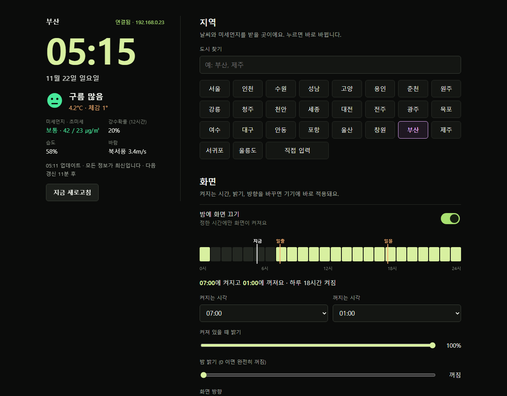 | 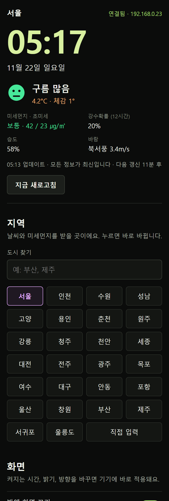 | 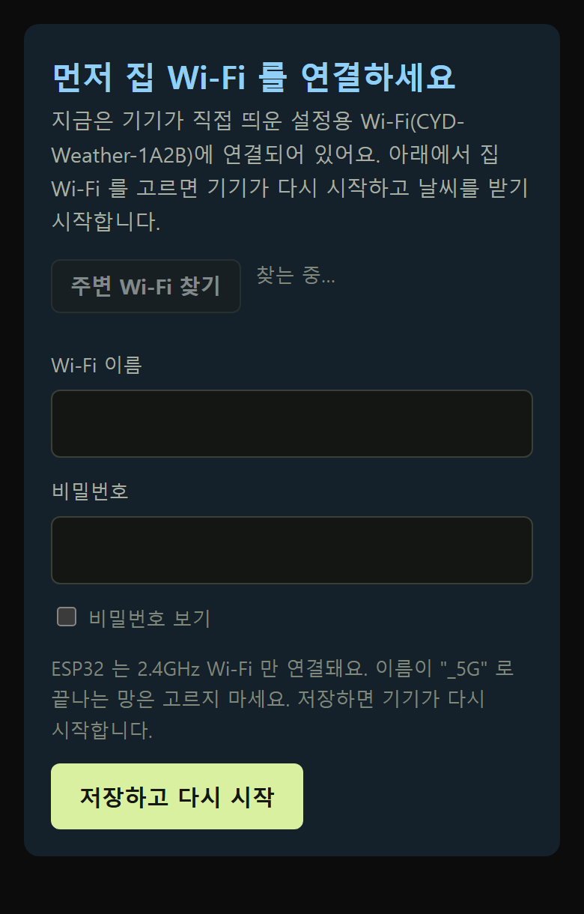 |

| 항목 | 할 수 있는 것 |
| --- | --- |
| 기기 상태 | 기기 시각, 지역, 날씨, 미세먼지, 강수확률, 마지막 업데이트, **지금 새로고침** |
| 지역 | 28개 도시 중 고르기(누르면 바로 적용), 도시 이름 찾기, **직접 입력**(이름 + 위도·경도). `37.5665, 126.9780` 처럼 붙여넣으면 위도·경도로 나눠 줍니다. 이름에 기기 글꼴에 없는 글자가 있으면 바로 알려줍니다 |
| 화면 | 밤에 화면 끄기 켬/끔, 켜지는/꺼지는 시각, **24시간 일정 띠**(켜지는 시간 · 일출 · 일몰 · 지금), 켜져 있을 때 밝기, 밤 밝기(0 = 꺼짐), 가로/세로, **화면 180° 뒤집기**(터치도 같이), **12시간제 시계**(오전/오후), 색 반전, 자동 넘김 |
| OpenWeather API 키 | 키 넣기 · 바꾸기 (끝 4자리만 표시) |
| Wi-Fi | 현재 연결과 신호, 주변 Wi-Fi 찾기, 다른 Wi-Fi 로 바꾸기 (저장하면 기기가 다시 시작) |
| 관리 비밀번호 | 설정하면 이 페이지를 열 때 비밀번호를 물어봅니다. 바꾸기 · 없애기 |
| 기기 | 터치 보정 시작, 다시 시작, 주소 · IP · 펌웨어 · 가동 시간 · 남은 메모리 |

바꾼 설정은 기기(NVS)에 저장되어 전원을 꺼도 유지되고, 밝기처럼 바로 보이는 값은 슬라이더를 움직이는 동안 기기 화면에 바로 반영됩니다.

### Wi-Fi 설정 모드 (처음 켤 때 · Wi-Fi 를 바꿨을 때)

Wi-Fi 정보가 없거나 30초 동안 연결하지 못하면, 기기가 직접 **`CYD-Weather-XXXX`** 라는 Wi-Fi 를 띄우고 화면에 안내를 보여줍니다.

1. 휴대폰 Wi-Fi 목록에서 `CYD-Weather-XXXX` 에 연결합니다 (비밀번호 없음).
2. 설정 페이지가 저절로 열립니다. 안 열리면 브라우저에서 `192.168.4.1` 로 들어갑니다.
3. 주변 Wi-Fi 목록에서 집 Wi-Fi 를 고르고 비밀번호를 넣은 뒤 **저장하고 다시 시작**을 누릅니다.
4. 휴대폰을 집 Wi-Fi 로 되돌리고 `http://cyd-weather-kr.local` 로 다시 들어갑니다.

집 Wi-Fi 에 연결되면 설정 모드 Wi-Fi 는 3분 뒤 자동으로 꺼집니다. 비밀번호가 틀렸으면 30초 뒤 다시 설정 모드가 켜집니다.

### 보안 메모

- 설정 웹은 집 안 네트워크용이라 HTTPS 가 아닌 HTTP 입니다. 공유기 밖(인터넷)으로 포트를 열지 마세요.
- 관리 비밀번호를 정하지 않으면 같은 Wi-Fi 의 누구나 설정을 바꿀 수 있습니다. 손님용 Wi-Fi 와 같은 망이라면 비밀번호를 정하세요.
- Wi-Fi 비밀번호와 관리 비밀번호는 페이지로 다시 내려보내지 않습니다.
- Wi-Fi 설정 모드는 연결을 쉽게 하려고 비밀번호 없이 열립니다. 설정하는 몇 분 동안만 켜집니다.

### 설정 웹 고치기

페이지 원본은 [`web/index.html`](web/index.html) 한 파일(외부 글꼴·라이브러리 없음)이고, 펌웨어에는 gzip 으로 압축해 넣습니다(약 13KB).

```powershell
python tools/web_mock.py          # 보드 없이 http://127.0.0.1:8765 에서 확인 (--ap: 설정 모드, --locked 1234: 비밀번호)
python tools/build_web.py         # web/index.html → CYD_Weather_KR/WebPage.h
```

기기가 제공하는 API: `GET /api/state` · `POST /api/settings` · `GET /api/glyphs?text=` · `GET /api/scan` · `POST /api/wifi` · `POST /api/refresh` · `POST /api/calibrate` · `POST /api/reboot` (비밀번호를 정했다면 `X-Admin-Password` 헤더 필요)

---

## 데이터와 기준

| 정보 | 출처 | 갱신 |
| --- | --- | --- |
| 현재 날씨, 일출·일몰 | OpenWeather `/data/2.5/weather` | 15분마다 (실패 시 1분 후 재시도) |
| 4일 예보, 강수확률 | OpenWeather `/data/2.5/forecast` (3시간 간격) | 15분마다 |
| 미세먼지 · 초미세먼지 · 자외선 | [Open-Meteo 대기질 API](https://open-meteo.com/en/docs/air-quality-api) (CAMS 모델, 키 없음) | 15분마다 |

- 무료 OpenWeather 요금제(분당 60회, 월 100만 회)에 비해 하루 약 200회만 사용합니다.
- 미세먼지는 **위성·모델 기반 추정값**이라 에어코리아 측정소 실측값과 조금 다를 수 있습니다.
- 통신은 모두 HTTPS이며 인증서를 검증합니다. 인터넷 시간(NTP)을 맞춘 뒤에 요청합니다.
- 통신이 잠깐 끊겨도 마지막으로 받은 정상 데이터를 계속 보여주고, 30분이 지나면 `지난 정보`로 표시합니다.

**미세먼지 등급** (환경부, 2018년 개정, ㎍/㎥)

| 등급 | 색 | PM10 | PM2.5 |
| --- | --- | --- | --- |
| 좋음 | 파랑 | 0–30 | 0–15 |
| 보통 | 초록 | 31–80 | 16–35 |
| 나쁨 | 주황 | 81–150 | 36–75 |
| 매우나쁨 | 빨강 | 151 이상 | 76 이상 |

**자외선 지수** (기상청): 낮음 0–2 · 보통 3–5 · 높음 6–7 · 매우높음 8–10 · 위험 11 이상
**바람 세기** (기상청 예보 용어): 약함 4m/s 미만 · 약간 강함 4–9 · 강함 9–14 · 매우 강함 14 이상

**생활 안내** (위에 있을수록 먼저 표시, 기준값은 `All_Settings.h`에서 조정)

| 조건 | 안내 |
| --- | --- |
| 체감온도 33℃ 이상 | 폭염 주의 · 체감 34° |
| 기온 −12℃ 이하 | 한파 주의 · 체감 −15° |
| 지금 비/눈 | 비 오는 중 · 우산 챙기세요 / 눈 오는 중 · 미끄럼 주의 |
| 풍속 14m/s 이상 | 강풍 주의 · 15 m/s |
| 미세먼지 매우나쁨 | 초미세먼지 매우나쁨 · 외출 자제 |
| 12시간 강수확률 60% 이상 | 우산 챙기세요 · 강수 70% |
| 미세먼지 나쁨 | 미세먼지 나쁨 · 마스크 권장 |
| 자외선 높음 이상 | 자외선 높음 · 선크림 필수 |
| 24시간 일교차 10℃ 이상 | 일교차 12° · 겉옷 챙기세요 |
| 맑음 + 공기 좋음 + 15~26℃ | 맑고 공기 좋음 · 산책하기 좋아요 |

---

## 한글 글꼴 다시 만들기

한글 11,172자를 모두 넣으면 플래시가 모자라서, **실제로 화면에 쓰는 글자만** 골라 글꼴을 만듭니다. 현재 약 420자, 플래시 약 265KB입니다.

| 이름 | 크기 | 쓰는 곳 | 글자 |
| --- | --- | --- | --- |
| `KR_FONT_SMALL` | 12px | 라벨, 본문 | 전체 |
| `KR_FONT_MEDIUM` | 16px | 값, 제목, 버튼 | 전체 |
| `KR_FONT_LARGE` | 22px | 날씨 설명, 날짜, 요일 | 날씨 문구·지역명·요일 |
| `KR_FONT_CLOCK` | 46px | 세로 화면 시계 | 숫자와 `:` |
| `KR_FONT_CLOCK_BIG` | 66px | 가로 화면 시계 | 숫자와 `:` |

글자는 소스의 **문자열 안에 있는 글자**(주석 제외)와 [`tools/extra_glyphs.txt`](tools/extra_glyphs.txt)(전국 시·도·시·군·구 이름 등)에서 모읍니다.
지역 이름이나 문구를 고쳤다면 다음을 실행하세요.

```powershell
pip install pillow fonttools
python tools/make_korean_fonts.py
```

시스템에 설치된 나눔고딕 Bold를 자동으로 찾습니다. 없으면 [네이버 한글한글 아름답게](https://hangeul.naver.com/font)에서 받아 설치하거나 `tools/fonts/` 폴더에 넣고, `--font 경로.ttf`로 다른 글꼴을 지정할 수도 있습니다.

## PC에서 화면 미리보기

보드 없이도 실제 화면 코드(`DisplayUI.cpp`)를 PC에서 그대로 컴파일해 결과를 PNG로 볼 수 있습니다. 레이아웃을 고친 뒤 글자가 잘리거나 글꼴에 없는 글자가 생겼는지 확인할 때 씁니다. README의 스크린샷도 이렇게 만들었습니다.

```powershell
pip install pillow
python tools/preview/render.py --cxx clang++
```

결과는 `images/preview-*.png`에 저장됩니다. 글꼴에 없는 글자가 있으면 `MISSING GLYPHS`를 출력하고 실패합니다.
Windows에서는 Visual Studio Build Tools의 "x64 Native Tools Command Prompt"에서 실행하세요 (clang++ 또는 g++가 C 표준 헤더를 찾아야 합니다).

---

## 문제 해결

### Windows 사용자 이름이 한글일 때 컴파일 실패

증상: 코드 컴파일은 되는데 마지막에 `cannot find -lrtc: Invalid argument`, `can't create ... .o: Invalid argument`, `ld returned 1 exit status`

원인: ESP32 툴체인(xtensa gcc)이 `C:\Users\홍길동\AppData\Local\Arduino15` 같은 **한글 경로**를 읽지 못합니다.

해결:
1. Arduino IDE를 닫습니다.
2. `C:\Users\<사용자>\AppData\Local\Arduino15` 폴더를 `C:\Arduino15`로 **이동**합니다.
3. `C:\Users\<사용자>\.arduinoIDE\arduino-cli.yaml`을 메모장으로 열어 `directories:` 아래를 이렇게 바꿉니다.
   ```yaml
   directories:
     data: C:\Arduino15
     downloads: C:\Arduino15\staging
     user: C:\Arduino
   ```
4. 스케치 폴더(`CYD_Weather_KR`)와 라이브러리도 `C:\Arduino\` 아래처럼 영문 경로에 두면 안전합니다.

### 화면이 하얗거나 아무것도 안 나옴

`libraries/`의 **TFT_eSPI zip**을 썼는지 확인하세요. 라이브러리 매니저의 기본 TFT_eSPI는 CYD 핀 설정이 없습니다. Partition Scheme, Flash Mode(DIO), 40MHz, 4MB도 확인하세요.

### 화면이 까맣고 백라이트도 안 켜짐

이전 버전에서 USB 단자가 2개(USB-C + Micro-USB)인 후기형 CYD 에서 생기던 문제입니다. 지금 펌웨어는 최대 밝기·꺼짐을 PWM 없이 직접 켜고 끄도록 고쳐져 있습니다.
설정 웹에서 밝기를 100% 아래로 내렸는데 화면이 꺼진다면 100% 로 되돌려 주세요.

### 바탕이 하얗고 색이 반대로 보임

패널 종류에 따라 색 반전이 필요합니다. 설정 웹의 **화면 → 화면 색 반전** 스위치를 바꾸거나, `All_Settings.h` 의 `DEFAULT_INVERT_COLORS` 를 바꾸세요.
USB 단자가 2개인 후기형 CYD 는 `true`(기본값), Micro-USB 하나뿐인 초기형은 `false` 입니다.

### 화면이 거꾸로 나옴

설정 웹의 **화면 → 화면 180° 뒤집기** 를 켜세요. 터치 방향도 같이 뒤집혀서 보정을 다시 할 필요가 없습니다.

### 터치한 곳과 반응하는 곳이 다름

아무 화면이나 2초 길게 눌러 터치 보정을 다시 하세요. 보정값은 방향별로 저장되므로 세로와 가로에서 각각 한 번씩 하면 됩니다.

### `LittleFS 데이터가 없습니다`

6단계의 LittleFS 업로드를 하지 않았거나 Partition Scheme이 다릅니다. 같은 보드·포트·파티션 설정으로 `data` 폴더를 다시 올리세요.

### 날씨가 안 나옴

시스템 화면 아래쪽 상태 문구를 확인하세요.

| 문구 | 의미 / 해결 |
| --- | --- |
| `Wi-Fi 연결 안 됨` | SSID·비밀번호 확인, **2.4GHz** 망인지 확인 |
| `인터넷 시간 맞추는 중 (NTP)` | 공유기에서 NTP(UDP 123) 차단 여부 확인 |
| `API 키 거부(401)` | 키 오타, 또는 새 키 활성화 대기(최대 2시간) |
| `호출 한도 초과(429)` | 다른 기기와 키를 같이 쓰는 중이면 예비 키 사용 |
| `응답 시간 초과` | 일시적인 문제, 1분 뒤 자동 재시도 |
| `서버 연결 실패` 가 계속됨 | 서버 인증서가 바뀌었을 수 있습니다. `ApiCertificates.h` 에 서버의 루트 인증서를 추가하세요 (2026-11: OpenWeather 가 Sectigo R46 체계로 바뀌어 추가해 둠). 시리얼 모니터에 `mbedtls` 오류가 함께 나옵니다 |

### 글자가 □로 보임

글꼴에 없는 글자입니다. [한글 글꼴 다시 만들기](#한글-글꼴-다시-만들기)를 실행하세요.

### 설정 웹이 계속 로딩만 됨 (또는 가끔 "연결 끊김")

기기와 공유기 사이 신호가 약하면 기기가 보내는 큰 패킷이 깨져서 페이지가 끝까지 내려오지 않습니다.
펌웨어는 약한 신호에 맞춰 Wi-Fi 채널 폭을 20MHz 로 고정하고, 보내는 패킷을 작게(MTU 576) 잘라 보냅니다.
실측: -80dBm 에서 페이지 0.3초, 상태 API 10/10 성공. 하지만 -85dBm 보다 낮으면 날씨도 웹도 불안정합니다.

- 시리얼 모니터에 `WIFI connected rssi=-79 dBm` 처럼 연결할 때의 신호가 찍힙니다. 시스템 화면의 Wi-Fi 줄에서도 볼 수 있습니다.
- -80dBm 보다 낮으면 기기를 공유기 쪽으로 옮기거나 방향을 바꾸세요. ESP32 안테나(보드 위쪽 은색 모듈 끝)가 모니터·금속에 가리지 않게 하면 10dB 가까이 좋아지기도 합니다.
- USB 케이블이 헐거우면 재부팅이 반복되어 같은 증상처럼 보입니다.

### 설정 웹 주소가 안 열림

- 휴대폰이 기기와 **같은 Wi-Fi** 에 있는지 확인하세요 (5GHz 와 2.4GHz 이름이 다른 공유기라도 보통 같은 망입니다).
- `cyd-weather-kr.local` 대신 기기 시스템 화면의 `설정 웹` IP 로 들어가세요.
- 공유기의 "AP 격리 / 무선 기기끼리 차단" 기능이 켜져 있으면 접속되지 않습니다.
- 관리 비밀번호를 잊었다면 `CYD_Weather_KR.ino` 의 `setup()` 맨 앞에 `resetSettings();` 를 한 줄 넣어 한 번 올리면 모든 설정이 기본값으로 돌아갑니다 (그다음 그 줄은 지우세요).

### 밤에 화면이 안 꺼지거나 아침에 안 켜짐

화면 일정은 인터넷 시간(KST) 기준이라 NTP 동기화 전에는 항상 켜져 있습니다. 시스템 화면의 `현재 시각`, `화면 일정`을 확인하세요. 밤에 터치하면 30초 동안 켜졌다가 다시 꺼집니다.

---

## 폴더 구조

| 경로 | 내용 |
| --- | --- |
| `CYD_Weather_KR/CYD_Weather_KR.ino` | 시작, 터치·제스처, 화면 일정(백라이트), 설정 적용, 방향별 터치 보정 |
| `CYD_Weather_KR/DeviceSettings.*` | 실행 중에 바꾸는 설정과 NVS 저장 |
| `CYD_Weather_KR/WebPortal.*` | 설정 웹 서버, API, 관리 비밀번호, Wi-Fi 설정 모드(캡티브 포털), mDNS |
| `CYD_Weather_KR/WebPage.h` | 자동 생성된 설정 웹 페이지 (gzip) |
| `web/index.html` | 설정 웹 페이지 원본 |
| `CYD_Weather_KR/DisplayUI.*` | 4개 화면의 세로·가로 레이아웃, 직접 그린 아이콘, 부팅 화면, 파일 점검 |
| `CYD_Weather_KR/WeatherNetwork.*` | HTTPS 갱신, 재시도, 예비 키, 지역 전환 |
| `CYD_Weather_KR/WeatherJson.*` | API 응답 검증과 해석 |
| `CYD_Weather_KR/WeatherModel.*` | 예보 가공, 한국어 표기, 등급 기준, 생활 안내, 터치 계산 (PC에서도 컴파일됨) |
| `CYD_Weather_KR/KoreanFonts.h` | 자동 생성된 한글 글꼴 (직접 고치지 않음) |
| `CYD_Weather_KR/All_Settings.h` | 지역, 시간대, 갱신 주기, 화면 일정, 화면 방향, 안내 기준, 핀 |
| `CYD_Weather_KR/data/` | LittleFS에 올리는 아이콘·달·바람 화살표·숫자 글꼴·부팅 이미지 |
| `libraries/` | 검증된 라이브러리 zip과 SHA-256 목록 |
| `tools/make_korean_fonts.py` | 한글 글꼴 생성기 |
| `tools/preview/` | PC 화면 미리보기 |
| `tools/build_web.py` · `tools/web_mock.py` | 설정 웹 압축 · 보드 없이 띄워 보는 가짜 기기 |
| `docs/` | 웹 설치 페이지(GitHub Pages, ESP Web Tools)와 API 키 없이 빌드한 펌웨어 |

---

## 만든 사람과 라이선스

- 원본: [Rau7han/ESP32-CYD-Weather-Station](https://github.com/Rau7han/ESP32-CYD-Weather-Station)
- 그 바탕: Michael Fehr의 [ESP32 CYD Weather Station with Forecast](https://github.com/AndroidCrypto/ESP32_CYD_Weather_Station_With_Forecast),
  Bodmer의 TFT_eSPI·LittleFS 그래픽 작업, ThingPulse / Daniel Eichhorn의 [color weather station](https://github.com/ThingPulse/esp8266-weather-station-color)
- 한글 글꼴: 네이버 **나눔고딕** (SIL Open Font License 1.1)

[`LICENSE`](LICENSE)(MIT)와 [`THIRD_PARTY_NOTICES.txt`](THIRD_PARTY_NOTICES.txt)를 참고하세요. 날씨·대기질 데이터는 각 제공처(OpenWeather, Open-Meteo/CAMS)의 이용 약관을 따릅니다.
